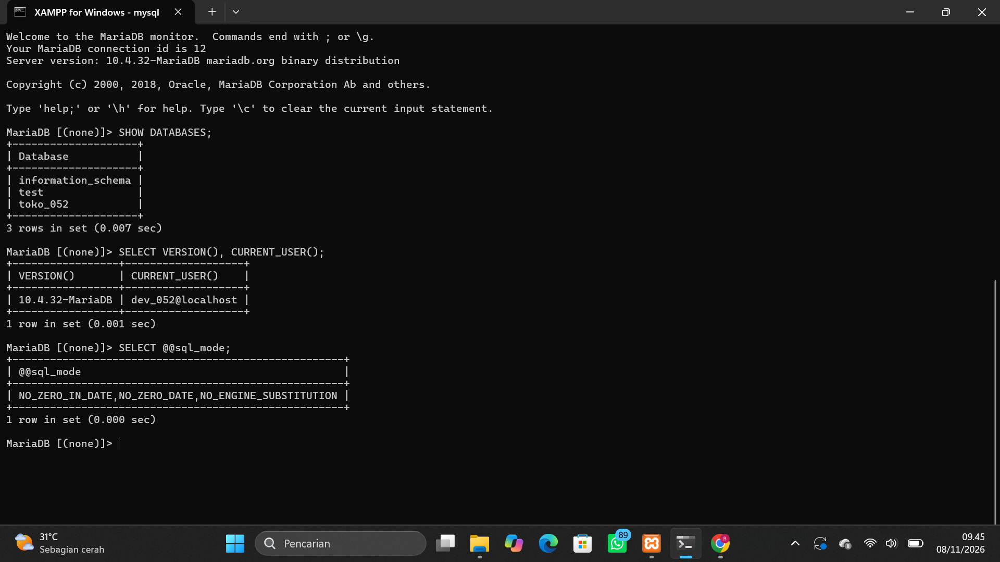
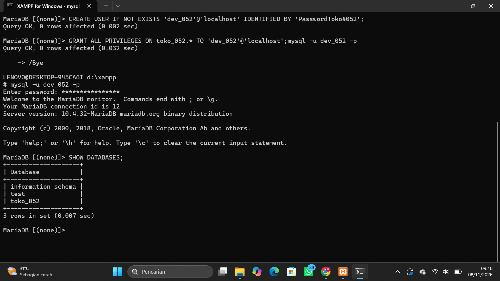
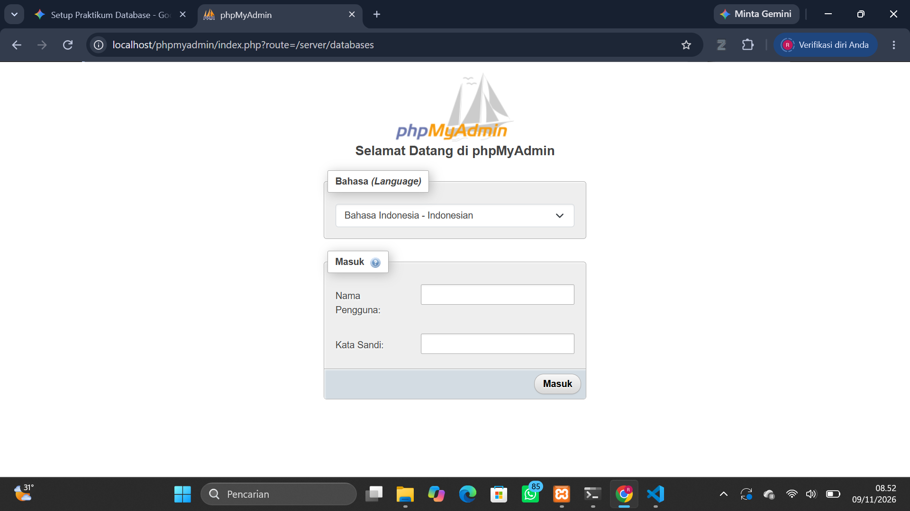
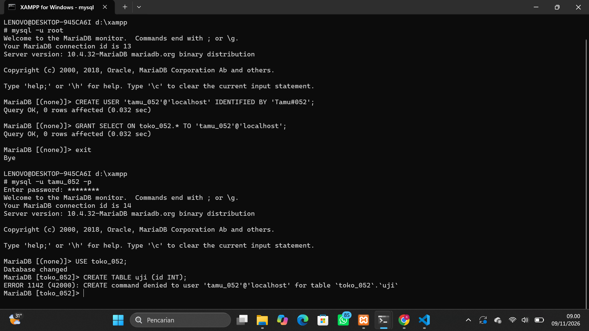
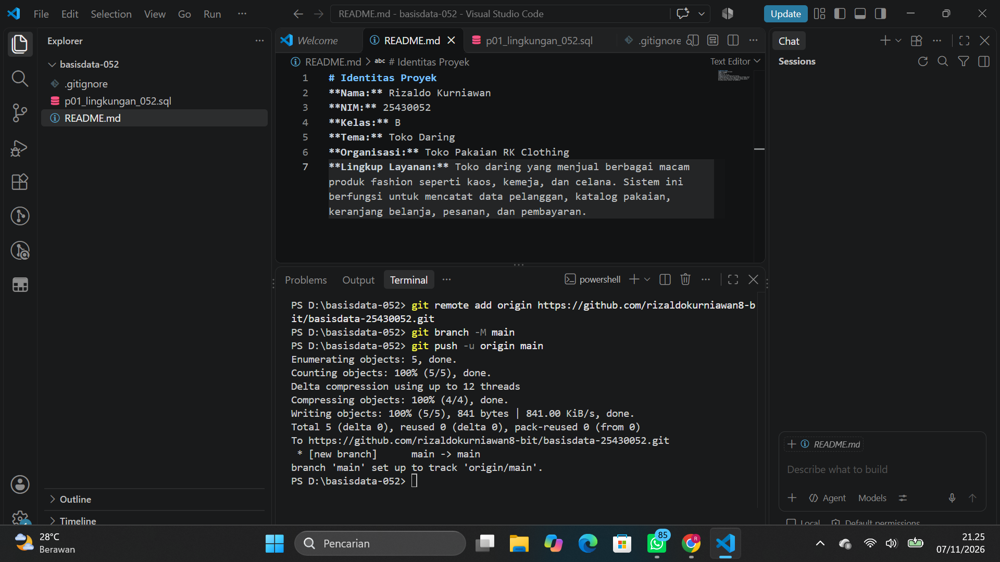

# Laporan Praktikum Basis Data
**Nama:** Rizaldo Kurniawan
**NIM:** 25430052
**Kelas:** B
**Tanggal:** 10 November 2026

## 1. Tujuan Praktikum
Praktikum ini bertujuan agar mahasiswa mampu mengelola layanan MariaDB di XAMPP, menghubungkan klien (CLI dan phpMyAdmin), mengamankan akun root, membuat akun kerja khusus beserta basis datanya, serta mencatat pekerjaan melalui Git dan GitHub.

## 2. Ringkasan Dasar Teori
Basis data membutuhkan Sistem Manajemen Basis Data (DBMS) seperti MariaDB untuk mengelola penyimpanan, keamanan, dan transaksi. MariaDB menggunakan arsitektur klien-server di mana server berjalan di *background* (port 3306) dan klien (seperti CLI atau phpMyAdmin) mengirimkan kueri SQL kepadanya. Untuk keamanan, diterapkan prinsip hak akses minimum di mana akun kerja hanya bisa mengakses basis datanya sendiri. Semua progres dicatat dalam sistem *version control* Git.

## 3. Hasil Langkah Percobaan
Berikut adalah bukti hasil percobaan pengaturan lingkungan:

**Bukti Versi MariaDB, Akun, dan SQL Mode:**

*Keterangan: Berhasil login sebagai dev_052 dan mode SQL ketat sudah aktif.*

**Bukti Database Proyek:**

*Keterangan: Akun dev_052 hanya dapat melihat information_schema, test, dan toko_052 miliknya.*

**Bukti Halaman phpMyAdmin (Mode Cookie):**

*Keterangan: Halaman login phpMyAdmin meminta username dan password karena auth_type diubah menjadi cookie.*

## 4. Jawaban Titik Analisis
**Titik Analisis 1:** Walaupun tombol di XAMPP berlabel "MySQL", server yang berjalan sebenarnya adalah MariaDB. Konsekuensinya, jika mencari solusi error di internet, kita harus merujuk pada dokumentasi MariaDB, terutama untuk fitur baru, karena ada perbedaan penanganan fitur tertentu dibandingkan MySQL murni.
**Titik Analisis 2:** Pesan galat 1045 menyebutkan `(using password: NO)`, yang artinya klien mencoba masuk tanpa mengirimkan password sama sekali (karena lupa menambahkan opsi `-p`).
**Titik Analisis 3:** `information_schema` tetap terlihat karena itu adalah database sistem bawaan yang berisi informasi tabel (metadata) yang boleh dilihat semua user. Galat 1044 muncul saat mencoba masuk ke `mysql` karena akun `dev_052` tidak memiliki hak akses (privileges) ke sana. Beda dengan galat 1045 yang merupakan masalah otentikasi (salah password).
**Titik Analisis 4:** Mode `cookie` lebih aman karena pengguna diwajibkan mengetik password setiap kali login. Pada mode `config`, password disimpan dalam bentuk teks biasa di dalam file `config.inc.php`, yang sangat rentan jika file tersebut bocor atau diakses orang lain di komputer yang sama.

## 5. Hasil Latihan dan Modifikasi
**Bukti Galat 1142 (Hak Akses Ditolak):**

*Keterangan: Pembuatan tabel ditolak karena akun tamu_052 hanya diberikan hak akses SELECT, bukan CREATE.*

## 6. Tugas Mandiri: Milestone Proyek 1
Telah dibuat repositori GitHub untuk proyek "Toko Pakaian RK Clothing" yang berisi file README.md, skrip SQL p01_lingkungan_052.sql, dan file .gitignore. Database `toko_052` dan akun `dev_052` telah berhasil dibuat dan dibuktikan pada tangkapan layar di bagian 3.

## 7. Pembahasan dan Kendala
Kendala utama yang dihadapi adalah sempat tertukar antara menjalankan perintah bash (Windows) dengan kueri MariaDB, sehingga muncul perintah yang "menggantung" (tanda `->`). Solusinya adalah dengan mengetik `\c` untuk membatalkan kueri dan `exit` untuk kembali ke Command Prompt Windows. Selain itu, terdapat pesan galat 1045 karena salah memasukkan password, yang diselesaikan dengan masuk kembali menggunakan opsi `-p` dan mengetik password dengan benar.

## 8. Kesimpulan
Lingkungan kerja basis data telah berhasil disiapkan dengan aman. Server MariaDB berjalan normal, akun root telah diamankan, dan akun kerja proyek (dev_052) telah dibatasi hak aksesnya. Seluruh riwayat pekerjaan telah terhubung dan tersimpan di GitHub.

## 9. Pernyataan Penggunaan AI
Saya menggunakan asisten AI Gemini untuk membantu memahami penyebab error di terminal (seperti membedakan environment Windows dan MariaDB monitor), memperbaiki salah ketik kueri, dan memandu langkah-langkah penggunaan Git di Visual Studio Code.

## 10. Bukti Git
**Bukti Push Pertama ke GitHub:**

## Checklist
- [x] Identitas lengkap (nama, NIM, kelas, pertemuan)
- [x] Tujuan ditulis ulang dengan bahasa sendiri
- [x] Ringkasan teori ditulis dengan bahasa sendiri
- [x] Tangkapan layar hasil langkah percobaan
- [x] Semua Titik Analisis dijawab
- [x] Hasil Latihan (skrip/gambar bukti)
- [x] Milestone Proyek (Tugas Mandiri) dijelaskan
- [x] Pembahasan galat dan kendala
- [x] Kesimpulan
- [x] Pernyataan penggunaan AI
- [x] Bukti commit dan push ke GitHub (tautan dan hash)
- [x] Keaslian: nama/NIM muncul di objek, jam sistem terlihat