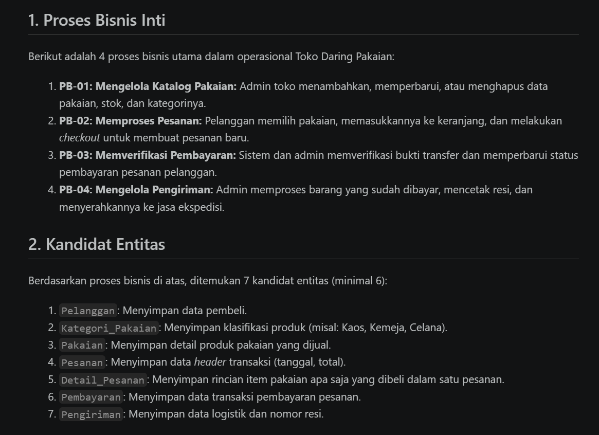
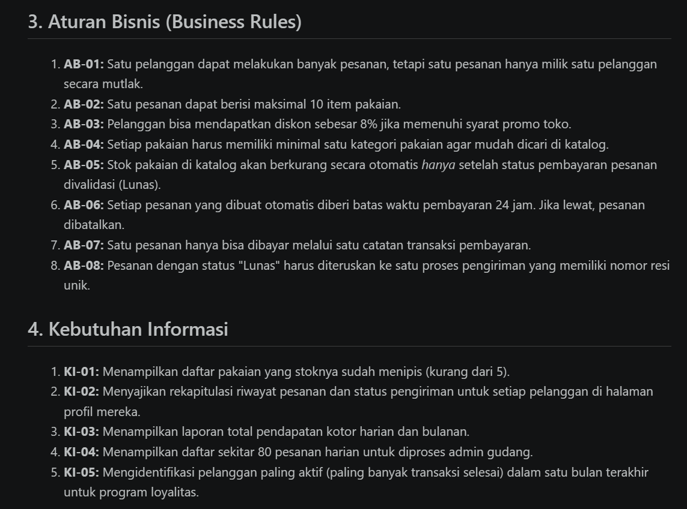
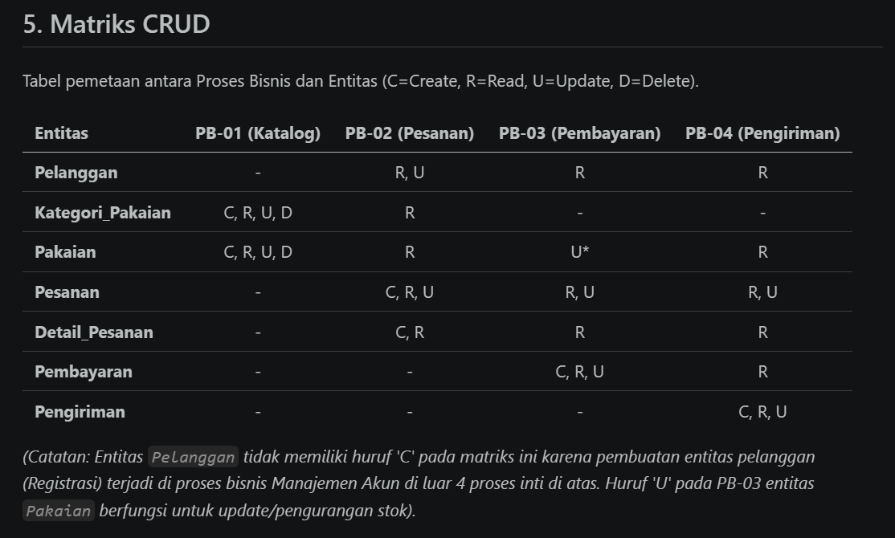
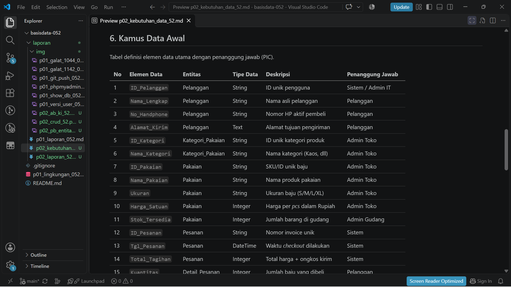
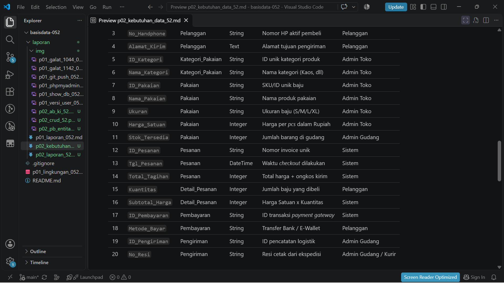

# Laporan Praktikum Basis Data - Pertemuan 02
**Nama:** Restu Kurniawan   **NIM:** 25430052   **Kelas:** B   **Tanggal:** 11 November 2026

## 1. Tujuan Praktikum
Memahami dan mampu menyusun dokumen kebutuhan data yang terdiri dari proses bisnis, entitas kandidat, aturan bisnis, kebutuhan informasi, matriks CRUD, serta kamus data awal untuk suatu sistem basis data.

## 2. Ringkasan Dasar Teori
Kebutuhan data merupakan fondasi dalam perancangan basis data. Analisis kebutuhan data dilakukan dengan mengidentifikasi proses bisnis inti, mengekstrak kandidat entitas dari dokumen sumber, serta menetapkan aturan bisnis yang mengatur batasan data. Selain itu, matriks CRUD digunakan untuk memetakan hak akses proses terhadap entitas, dan kamus data disusun untuk mendefinisikan detail setiap elemen data secara spesifik.

## 3. Hasil Langkah Percobaan
*(Catatan: Bagian ini opsional untuk disi dengan tangkapan layar langkah D.1 - D.6 skenario Kopma jika diinstruksikan oleh asisten praktikum. Jika tidak, cukup tulis "Telah mengikuti dan mempraktikkan penyusunan kebutuhan data skenario Kopma sesuai panduan buku.")*

## 4. Jawaban Titik Analisis
**Titik Analisis 1:**
Harga pada nota wajib disimpan secara terpisah ("harga saat transaksi") karena harga barang fluktuatif. Jika nota hanya menarik "harga barang" dari master data, maka saat harga master berubah, total transaksi masa lalu akan ikut berubah (tidak valid). Hal ini relevan dengan keluhan ketua koperasi mengenai laporan omzet yang berantakan.

**Titik Analisis 2:**
* **Alasan TIDAK menyimpannya:** Untuk menghindari anomali (inkonsistensi data) dan menghemat *storage*, karena total selalu bisa dikalkulasi dinamis (*harga_satuan x qty*).
* **Alasan TETAP menyimpannya:** Untuk meningkatkan performa sistem. Pada volume transaksi yang sangat besar, menyimpan hasil perhitungan akan mempercepat *query* pembuatan laporan tanpa membebani *database* dengan perhitungan ulang.

**Titik Analisis 3:**
* **Makna tidak ada huruf C pada Pemasok:** Artinya belum ada proses bisnis yang dirancang untuk menambahkan data Pemasok baru ke dalam sistem (anomali).
* **Proses yang perlu ditambahkan:** **PB-06 Pendataan Pemasok**.
* **Siapa yang mengubah status aktif anggota:** Perlu ditambahkan proses **PB-07 Manajemen Status Anggota** yang dikelola oleh Ketua Koperasi.

## 5. Hasil Latihan dan Modifikasi
**Modifikasi Sistem Poin Loyalitas Kopma:**
* **Elemen Data Tambahan:** `Saldo_Poin_Anggota`, `Poin_Diperoleh_Transaksi`, `Poin_Ditukar_Transaksi`.
* **Aturan Bisnis (AB):**
  * **AB-07:** Sistem memberikan 1 poin untuk setiap kelipatan Rp10.000 belanja dalam satu transaksi.
  * **AB-08:** Anggota dapat menukar 50 poin untuk potongan Rp5.000.
* **Kebutuhan Informasi (KI):**
  * **KI-06:** Menampilkan jumlah saldo poin loyalitas anggota.
  * **KI-07:** Menyajikan laporan riwayat perolehan dan penukaran poin.
* **Pembaruan Matriks CRUD:** Pada "Transaksi Penjualan", entitas `Anggota` diberi aksi **Update (U)** untuk penyesuaian saldo poin.

**Perbaikan Pernyataan Kebutuhan Kabur:**
* **(a)** Sistem membatasi akses data alamat dan no telepon hanya kepada admin, serta mengenkripsi kata sandi.
* **(b)** Sistem mampu menampilkan hasil pencarian katalog pakaian berdasarkan kata kunci dalam waktu < 2 detik.
* **(c)** Sistem mengurangi stok barang secara otomatis dan *real-time* setelah status pembayaran divalidasi berhasil.

## 6. Tugas Mandiri: Milestone Proyek 02
**Tautan Berkas Proyek:** [Masukkan Link file p02_kebutuhan_data_52.md di GitHub lu]

**Perhitungan Parameter P:**
Berdasarkan dua digit terakhir NIM (52):
* **Nilai P:** (52 mod 9) + 1 = 7 + 1 = **8**.
* **Batas maksimal item per transaksi:** P + 2 = **10 item**.
* **Persentase diskon toko:** P = **8%**.
* **Perkiraan volume transaksi harian:** 40 + (5 x 8) = **80 nota/hari**.

**Bukti Tangkapan Layar Proyek Toko Daring:**
1. **Tabel Proses Bisnis & Kandidat Entitas:**
   
2. **Tabel Aturan Bisnis & Kebutuhan Informasi:**
   
3. **Matriks CRUD:**
   
4. **Kamus Data (Bag. 1):**
   
5. **Kamus Data (Bag. 2):**
   

## 7. Pembahasan dan Kendala
Dalam merancang kebutuhan data, tantangan utama adalah memastikan tidak ada entitas yang tertinggal dalam Matriks CRUD (memastikan semua entitas memiliki siklus C-R-U-D yang logis) dan menentukan batasan aturan bisnis yang spesifik sesuai parameter P.

## 8. Kesimpulan
Dokumen kebutuhan data yang komprehensif (mencakup PB, Entitas, AB, KI, Matriks CRUD, dan Kamus Data) sangat penting untuk memastikan tidak ada anomali atau kebutuhan sistem yang terlewat sebelum masuk ke tahap perancangan ERD.

## 9. Pernyataan Penggunaan AI
Saya menggunakan AI (Google Gemini) sebagai mitra diskusi untuk mengevaluasi perhitungan parameter P, memvalidasi normalisasi matriks CRUD, serta membantu memperbaiki tata bahasa Markdown pada laporan ini. Keputusan akhir terkait desain entitas dan analisis tetap menjadi tanggung jawab saya sendiri.

## 10. Bukti Git
* **Tautan Repositori:** https://github.com/rizaldokurniawan8-bit/basisdata-25430052.git
* **Hash Commit Terakhir:** 98007b9

## Checklist
- [x] Laporan menggunakan format Markdown
- [x] Terdapat link ke berkas `p02_kebutuhan_data_52.md`
- [x] Tangkapan layar proyek tampil dengan baik
- [x] Titik analisis 1-3 terjawab