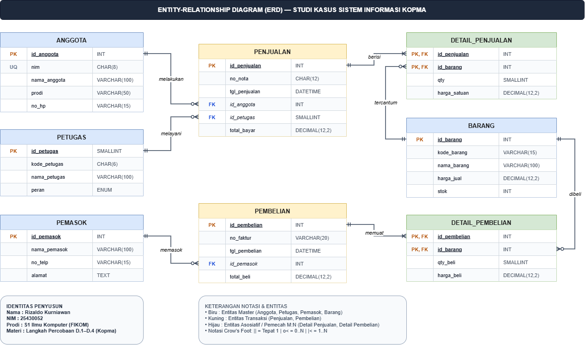
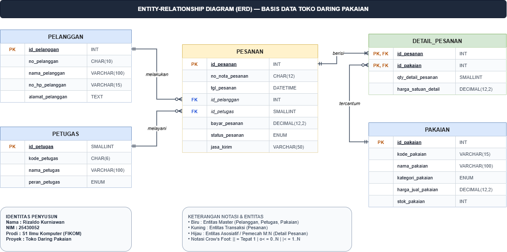

# Laporan Praktikum Basis Data
**Nama:** Rizaldo Kurniawan
**NIM:**  25430052
**Kelas:** B
**Tanggal:** 14 November 2026
Pertemuan 03

## 1. Tujuan Praktikum
1. Mengidentifikasi entitas, atribut, dan kunci dari dokumen kebutuhan data.
2. Menentukan relasi beserta kardinalitas dan partisipasinya berdasarkan aturan bisnis.
3. Memecah relasi banyak-ke-banyak menjadi entitas asosiatif.
4. Menggambar ERD dengan notasi Crow's Foot dan memvalidasinya terhadap Kebutuhan Informasi (KI).

## 2. Ringkasan Dasar Teori
Model *Entity-Relationship* (ER) memodelkan data sebagai entitas (objek), atribut (sifat), dan relasi (hubungan). Kardinalitas menjawab batas maksimum jumlah relasi, sedangkan partisipasi menjawab batas minimum (wajib atau opsional), yang digambarkan menggunakan notasi *Crow's Foot*. Untuk relasi banyak-ke-banyak (M:N), diperlukan entitas asosiatif sebagai pemecah relasi yang dapat memiliki atributnya sendiri.

## 3. Hasil Langkah Percobaan

## 4. Jawaban Titik Analisis
* **Titik Analisis 1:** Penggunaan `id_anggota` (kunci pengganti) lebih aman karena NIM bisa saja salah ketik saat pendaftaran atau berubah. Jika NIM dijadikan kunci primer, perbaikan data NIM akan merepotkan karena harus melakukan pembaruan merambat (*cascade update*) ke seluruh tabel transaksi yang merujuknya.
* **Titik Analisis 2:** Sisi penjualan terhadap `detail_penjualan` bernilai "satu atau banyak" karena dipaksa oleh **AB-01** (Setiap nota memiliki minimal satu baris barang). Aturan "minimal satu" ini tidak dapat dijaga hanya dengan struktur tabel, melainkan harus ditangani pada level transaksi (Modul 14).
* **Titik Analisis 3:** ERD saat ini belum dapat menjawabnya karena tidak ada relasi langsung antara `petugas` dan `pembelian`. Perlu ditambahkan relasi dari `petugas` (gudang) ke `pembelian`, dan hal ini harus dicatat sebagai Aturan Bisnis baru (misal: "Penerimaan barang dari pemasok dicatat oleh petugas gudang").

## 5. Hasil Latihan dan Modifikasi
* **Penambahan Poin Loyalitas:** Atribut `poin_loyalitas` ditambahkan pada entitas `anggota` (bertipe `INT` dengan nilai default `0`) karena poin melekat pada masing-masing akun anggota dan bertambah setiap kali transaksi selesai.
* **Relasi M:N Tanpa Entitas Asosiatif:** Jika relasi banyak-ke-banyak antara `penjualan` dan `barang` tidak dipecah menggunakan entitas asosiatif `detail_penjualan`, maka data jumlah beli (`qty`) dan harga jual saat transaksi tidak memiliki tempat penyimpanan yang spesifik per item barang, serta akan menimbulkan duplikasi data berulang pada tabel transaksi.

## 6. Tugas Mandiri: Milestone Proyek 3
Tema Proyek: Toko Daring Pakaian

**A. Gambar ERD Proyek**

**B. Tabel Relasi dan Kardinalitas**
| Relasi                                     | Sisi Kiri (Entitas) | Sisi Kanan (Entitas)    | Dasar (Aturan Bisnis)                                                 |
| :----------------------------------------- | :------------------ | :---------------------- | :-------------------------------------------------------------------- |
| **pelanggan** `melakukan` **pesanan**      | Tepat satu (1)      | Nol atau banyak (0..N)  | **AB-02:** Setiap pesanan wajib dilakukan oleh pelanggan terdaftar.   |
| **petugas** `melayani` **pesanan**         | Tepat satu (1)      | Nol atau banyak (0..N)  | **AB-03:** Setiap pesanan diproses dan diverifikasi oleh petugas.     |
| **pesanan** `berisi` **detail_pesanan**    | Tepat satu (1)      | Satu atau banyak (1..N) | **AB-01:** Setiap transaksi pesanan minimal memuat satu item pakaian. |
| **pakaian** `tercantum` **detail_pesanan** | Tepat satu (1)      | Nol atau banyak (0..N)  | **AB-04:** Harga satuan pakaian dicatat per baris detail pesanan.     |

**C. Entitas Asosiatif**
Terdapat satu entitas asosiatif yaitu `detail_pesanan` yang memecah relasi banyak-ke-banyak antara `pesanan` dan `pakaian`. Atribut miliknya sendiri adalah:
* `qty_detail_pesanan`
* `harga_satuan_detail_pesanan`

**D. Tabel Penelusuran KI ke Jalur ERD**
| Kode KI | Kebutuhan Informasi | Jalur Penelusuran di ERD |
| :--- | :--- | :--- |
| KI-01 | Laporan omzet penjualan bulanan | `pesanan` -> `detail_pesanan` |
| KI-02 | 5 pakaian terlaris bulan ini | `pakaian` -> `detail_pesanan` -> `pesanan` |
| KI-03 | Daftar pakaian dengan stok menipis | `pakaian` (difilter berdasarkan stok) |
| KI-04 | Pelanggan dengan total belanja terbesar | `pelanggan` -> `pesanan` -> `detail_pesanan` |

**E. Catatan Tinjauan Klien**
* **Umpan Balik 1:** Klien menanyakan letak status pengiriman dan jasa kurir yang dipakai pelanggan.
  * **Keputusan:** Diterima. Atribut `status_pesanan` dan `jasa_kirim` ditambahkan ke entitas `pesanan`.
* **Umpan Balik 2:** Klien menyarankan agar jasa kurir dibuat menjadi tabel entitas master tersendiri.
  * **Keputusan:** Ditolak. Karena data operasional kurir sangat statis dan tidak memerlukan pelacakan per kurir secara detail di internal sistem ini, cukup dijadikan atribut di tabel pesanan saja.

## 7. Pembahasan dan Kendala
Menentukan batas minimal (partisipasi) kardinalitas awalnya sedikit membingungkan, namun dapat diatasi dengan secara ketat merujuk ulang ke daftar Aturan Bisnis yang sudah disusun pada Modul 2.

## 8. Kesimpulan
Pemodelan ERD sangat membantu dalam memvisualisasikan dokumen kebutuhan data ke dalam bentuk hubungan antar tabel. Validasi penelusuran KI pada ERD juga memastikan bahwa tidak ada entitas atau atribut yang terlewat dari perancangan database.

## 9. Pernyataan Penggunaan AI
Menggunakan AI (Gemini) sebatas untuk berdiskusi merumuskan draft tabel relasi proyek, struktur penelusuran KI, serta format Markdown laporan. Gambar diagram dan eksekusi tetap dilakukan secara mandiri.

## 10. Bukti Git
* **Tautan Repositori:** https://github.com/rizaldokurniawan8-bit/basisdata-25430052.git
* **Hash Commit (p03):** b2b41a5

## 11. Checklist
- [x] Identitas lengkap
- [x] Tujuan ditulis pakai bahasa sendiri
- [x] Ringkasan teori
- [x] Tangkapan layar Langkah Percobaan
- [x] Titik Analisis dijawab lengkap
- [x] Hasil Latihan (E)
- [x] Tugas Mandiri (Milestone)
- [x] Kesimpulan & Pembahasan
- [x] Pernyataan AI
- [x] Bukti Git
- [x] Berkas `p03_erd_kopma_052` dan `p03_erd_052` ter-push