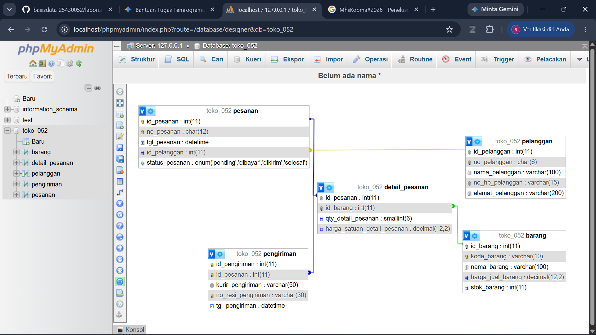

# Laporan Praktikum Basis Data - Pertemuan 05
**Nama:** Rizaldo Kurniawan     **NIM:** 25430052     **Kelas:** B     **Tanggal:** 14 Oktober 2026

## 1. Tujuan Praktikum
Mampu mengimplementasikan Data Definition Language (DDL) untuk membuat tabel, mendefinisikan tipe data, serta menerapkan batasan (constraint) seperti Primary Key, Foreign Key, Check, dan Unique pada basis data relasional. Mampu menghasilkan ERD fisik dari basis data yang telah dibangun.

## 2. Ringkasan Dasar Teori
DDL (Data Definition Language) adalah kumpulan perintah SQL yang digunakan untuk mendefinisikan, mengubah, dan menghapus struktur basis data seperti tabel, indeks, dan relasi. Perintah utama DDL meliputi CREATE, ALTER, dan DROP. Constraint digunakan untuk menjaga integritas data, contohnya PRIMARY KEY untuk keunikan baris, FOREIGN KEY untuk referensi antar tabel, dan CHECK untuk memvalidasi nilai sesuai aturan yang ditetapkan.

## 3. Hasil Langkah Percobaan
Telah menyelesaikan percobaan sesuai panduan modul praktikum.

## 4. Jawaban Titik Analisis
Sesuai dengan pelaksanaan di kelas praktikum.

## 5. Hasil Latihan dan Modifikasi
1. **Menambahkan constraint `stok_min_barang` tidak negatif:**
   `ALTER TABLE barang ADD CONSTRAINT ck_barang_stok_min CHECK (stok_min_barang >= 0);`

2. **Mengubah aksi `fk_penjualan_anggota` menjadi `ON DELETE SET NULL`:**
   `ALTER TABLE penjualan DROP FOREIGN KEY fk_penjualan_anggota;`
   `ALTER TABLE penjualan ADD CONSTRAINT fk_penjualan_anggota FOREIGN KEY (id_anggota) REFERENCES anggota (id_anggota) ON DELETE SET NULL;`

   **Analisis/Diskusi:** Perubahan ini sesuai dengan Aturan Bisnis (AB-02) karena Kopma mengizinkan penjualan untuk pembeli umum (nilai `id_anggota` menjadi `NULL`). Langkah ini juga sejalan dengan UU Pelindungan Data Pribadi (UU PDP). Jika anggota meminta penghapusan datanya (Right to Erasure), baris data anggota bisa dihapus tanpa merusak/menghapus riwayat transaksi di tabel penjualan, sehingga laporan omzet Kopma tetap valid.

## 6. Tugas Mandiri: Milestone Proyek 05
- Telah membuat skrip DDL `p05_ddl_25430052.sql` untuk basis data `toko_052`.
- Telah mengimplementasikan parameter P (P+2 = 10 maksimal item per transaksi) pada tabel `detail_pesanan` menggunakan constraint CHECK `(qty_detail_pesanan <= 10)`.
- **Utang Desain:** Pembatasan jenis barang pada satu transaksi utuh tidak dapat ditangani hanya dengan constraint CHECK (karena melibatkan agregasi multi-baris), dan akan diatasi dengan mekanisme Transaction di Modul 14.

**Dokumentasi Pemetaan Tipe Data:**

| Nama Tabel | Nama Kolom | Tipe Data Rancangan | Tipe Data Fisik (MySQL) | Keterangan / Alasan |
| :--- | :--- | :--- | :--- | :--- |
| **pelanggan** | id_pelanggan | Integer | INT(11) | Auto Increment, Primary Key |
| pelanggan | no_pelanggan | String | CHAR(6) | Panjang karakter tetap |
| pelanggan | nama_pelanggan | String | VARCHAR(100) | Panjang nama bervariasi |
| pelanggan | no_hp_pelanggan | String | VARCHAR(15) | Nomor HP maksimal 15 digit |
| pelanggan | alamat_pelanggan | String | VARCHAR(200) | Teks panjang untuk alamat |
| **barang** | id_barang | Integer | INT(11) | Auto Increment, Primary Key |
| barang | kode_barang | String | VARCHAR(10) | Identitas unik barang |
| barang | nama_barang | String | VARCHAR(100) | Nama barang |
| barang | harga_jual_barang | Decimal | DECIMAL(12,2) | Angka presisi untuk harga |
| barang | stok_barang | Integer | INT(11) | Bilangan bulat untuk jumlah |
| **pesanan** | id_pesanan | Integer | INT(11) | Auto Increment, Primary Key |
| pesanan | no_pesanan | String | CHAR(12) | Nomor identitas pesanan baku |
| pesanan | tgl_pesanan | Date/Time | DATETIME | Mencatat waktu transaksi pasti |
| pesanan | id_pelanggan | Integer | INT(11) | Foreign Key dari tabel pelanggan |
| pesanan | status_pesanan | Enum | ENUM('pending',...) | Dibatasi pilihan status spesifik |
| **detail_pesanan**| id_pesanan | Integer | INT(11) | Foreign Key dari tabel pesanan |
| detail_pesanan| id_barang | Integer | INT(11) | Foreign Key dari tabel barang |
| detail_pesanan| qty_detail_pesanan| Integer | SMALLINT(6) | Kuantitas barang (batas angka kecil) |
| detail_pesanan| harga_satuan_detail_pesanan | Decimal | DECIMAL(12,2) | Merekam harga saat transaksi |
| **pengiriman**| id_pengiriman | Integer | INT(11) | Auto Increment, Primary Key |
| pengiriman | id_pesanan | Integer | INT(11) | Foreign Key dari tabel pesanan |
| pengiriman | kurir_pengiriman | String | VARCHAR(50) | Nama jasa ekspedisi |
| pengiriman | no_resi_pengiriman | String | VARCHAR(30) | Nomor pelacakan paket |
| pengiriman | tgl_pengiriman | Date/Time | DATETIME | Mencatat waktu dikirim |

**Hasil Perbandingan Designer dengan ERD Fisik:**
Berdasarkan hasil generate fitur *Designer* pada phpMyAdmin, struktur fisik tabel basis data `toko_052` beserta relasi kunci tamu (Foreign Key) sudah sesuai secara utuh dengan rancangan ERD fisik awal. Kardinalitas terhubung dengan benar (misalnya `pelanggan` (1) ke `pesanan` (N), dan `barang` (1) ke `detail_pesanan` (N)). Seluruh konversi tipe data konseptual ke tipe data spesifik MySQL (seperti CHAR, VARCHAR, DECIMAL, DATETIME, dan ENUM) juga telah terpetakan dengan tepat tanpa ada penolakan tipe data (error 150).

**ERD Fisik:**

## 7. Pembahasan dan Kendala
**Kendala:** Sempat terjadi kendala error gagal masuk phpMyAdmin di awal ("No connection could be made because the target machine actively refused it").
**Solusi:** Server MySQL di XAMPP belum berjalan. Kendala ini teratasi dengan menekan tombol "Start" pada modul MySQL di XAMPP Control Panel sebelum mengakses halaman login phpMyAdmin kembali.

## 8. Kesimpulan
Praktikum Pertemuan 05 telah berhasil dilaksanakan. Penggunaan DDL dan constraint sangat krusial dalam perancangan basis data untuk memastikan struktur data sudah kuat dan menjamin integritas serta validitas data yang akan masuk ke dalam tabel.

## 9. Pernyataan Penggunaan AI
Saya menggunakan AI Gemini untuk membantu mengarahkan penyusunan skrip DDL toko daring, membantu menganalisis pesan error pada phpMyAdmin, dan menyusun draf laporan format Markdown.

## 10. Bukti Git
**Tautan Repositori:** https://github.com/rizaldokurniawan8-bit/basisdata-25430052
**Hash Commit:** 56776f67fedce158d6a0877cdca80e6425b8e0ed

## Checklist
- [x] Laporan menggunakan format Markdown `.md`
- [x] Gambar diletakkan pada direktori `laporan/img/`
- [x] Struktur urutan laporan sesuai dengan kerangka baku
- [x] Menyertakan Bukti Git (Tautan dan Hash)