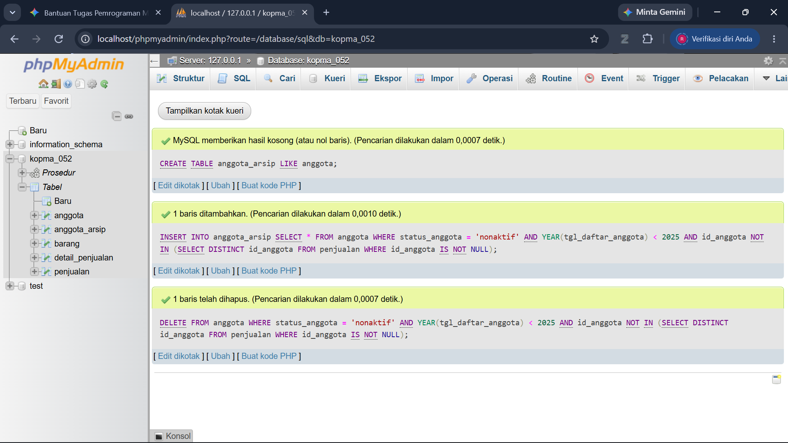
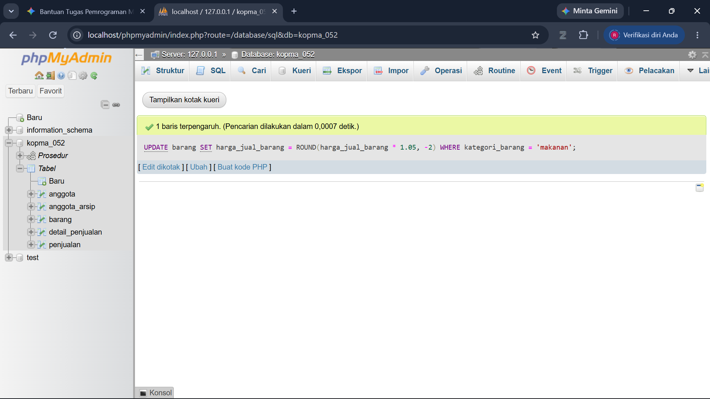

# Laporan Praktikum Basis Data - Pertemuan 06
**Nama:** Rizaldo Kurniawan     **NIM:** 25430052     **Kelas:** B     **Tanggal:** 30 Oktober 2026

## 1. Tujuan Praktikum
Mahasiswa mampu menggunakan perintah Data Manipulation Language (DML) tingkat lanjut seperti UPDATE dan DELETE dengan kondisi kompleks. Mahasiswa mampu memanipulasi data antar tabel menggunakan kombinasi INSERT INTO ... SELECT.

## 2. Ringkasan Dasar Teori
DML (Data Manipulation Language) tingkat lanjut memungkinkan manipulasi data antar tabel secara langsung. Perintah INSERT INTO ... SELECT digunakan untuk menyalin data hasil query dari satu tabel ke tabel lain, yang sangat berguna untuk mekanisme pengarsipan. Klausa WHERE dapat dikombinasikan dengan subquery menggunakan operator IN atau NOT IN. Fungsi bawaan seperti ROUND() juga dapat disisipkan langsung ke dalam statement UPDATE untuk modifikasi nilai.

## 3. Hasil Langkah Percobaan
Telah menyelesaikan percobaan sesuai panduan modul praktikum.

## 4. Jawaban Titik Analisis
**Titik Analisis 1:**
Menggunakan `INSERT ... SELECT` lebih aman karena mencegah kesalahan ketik manual (*human error*) dan memastikan harga yang dicatat sama persis dengan harga master yang berlaku di tabel barang pada saat transaksi. Setelah harga pulpen naik minggu depan, nota lama tidak akan ikut berubah.

**Titik Analisis 2:**
Menghapus nota ikut menghapus detailnya karena relasi (kunci tamu) pada tabel `detail_penjualan` menggunakan aksi `ON DELETE CASCADE`. Sebaliknya, menghapus petugas ditolak karena relasinya menggunakan aksi bawaan (`RESTRICT`), sehingga mencegah terhapusnya data induk yang masih dipakai di transaksi.

**Titik Analisis 3:**
Satu uji yang gagal (Utang Desain): "Melakukan transaksi penjualan dengan kuantitas (*qty*) melebihi stok yang tersedia". Constraint `CHECK` pada tabel barang tidak bisa mencegahnya saat kita memasukkan data ke `detail_penjualan`. Akan diatasi dengan mekanisme *Transaction* atau *Trigger* di Modul 14.

## 5. Hasil Latihan dan Modifikasi
**1. Arsip Anggota dan Hapus Data Lama**

**2. Naikkan Harga Makanan 5%**

## 6. Tugas Mandiri: Milestone Proyek 06
**Skenario Uji DML - Proyek Toko Daring**
**Tema:** Toko Pakaian RK Apparel

| No | ID Aturan | Deskripsi Pengujian | Jenis Uji | Kueri Uji (Contoh) | Hasil yang Diharapkan |
|---|---|---|---|---|---|
| 1 | AB-01 | Memasukkan data pelanggan baru dengan format valid. | Positif | `INSERT INTO pelanggan (id_pelanggan, no_pelanggan, nama_pelanggan, no_hp_pelanggan, alamat_pelanggan) VALUES (6, 'CUS006', 'Fajar', '0866666666', 'Bandar Lampung');` | Data berhasil disimpan. |
| 2 | AB-02 | Memasukkan data barang baru dengan data valid. | Positif | `INSERT INTO barang (id_barang, kode_barang, nama_barang, harga_jual_barang, stok_barang) VALUES (6, 'BRG06', 'Topi RK', 45000, 20);` | Data berhasil disimpan. |
| 3 | AB-03 | Memasukkan pesanan baru dengan data valid. | Positif | `INSERT INTO pesanan (id_pesanan, no_pesanan, tgl_pesanan, id_pelanggan, status_pesanan) VALUES (200, 'ORD-200', '2026-10-27 10:00:00', 1, 'pending');` | Data berhasil disimpan. |
| 4 | AB-04 | Memasukkan detail pesanan dengan kuantitas valid. | Positif | `INSERT INTO detail_pesanan (id_pesanan, id_barang, qty_detail_pesanan, harga_satuan_detail_pesanan) VALUES (200, 1, 2, 55000);` | Data berhasil disimpan. |
| 5 | AB-05 | (Negatif) Harga jual barang tidak boleh negatif (di bawah Rp 0). | Negatif | `INSERT INTO barang (id_barang, kode_barang, nama_barang, harga_jual_barang, stok_barang) VALUES (7, 'BRG07', 'Kaus Kaki', -10000, 50);` | Gagal/Ditolak. Error *constraint* (Check/Harga). |
| 6 | AB-06 | (Negatif) ID Pelanggan tidak boleh ganda (Duplikat PK). | Negatif | `INSERT INTO pelanggan (id_pelanggan, nama_pelanggan) VALUES (1, 'Kloningan Andi');` | Gagal/Ditolak. Error *Primary Key constraint*. |
| 7 | AB-07 | (Negatif) Kuantitas beli di detail_pesanan tidak boleh 0. | Negatif | `INSERT INTO detail_pesanan (id_pesanan, id_barang, qty_detail_pesanan, harga_satuan_detail_pesanan) VALUES (200, 2, 0, 125000);` | Gagal/Ditolak. Error *constraint* (Check/Qty). |
| 8 | AB-08 | (Negatif) Membuat pesanan untuk ID Pelanggan yang tidak terdaftar. | Negatif | `INSERT INTO pesanan (id_pesanan, no_pesanan, id_pelanggan) VALUES (201, 'ORD-201', 999);` | Gagal/Ditolak. Error *Foreign Key*. |
| 9 | AB-09 | (Negatif) Menghapus data Barang yang sudah tercatat di transaksi pesanan aktif. | Negatif | `DELETE FROM barang WHERE id_barang = 1;` | Gagal/Ditolak. Error *Foreign Key* (Restrict). |
| 10 | AB-10 | (Utang Desain) Stok barang berkurang otomatis saat detail_pesanan dibuat. | Gagal | (1) Cek stok. (2) `INSERT` detail_pesanan. (3) Cek stok lagi. | Uji Gagal. Stok tidak berkurang otomatis. (Tunggu Modul 14). |

## 7. Pembahasan dan Kendala
Kendala awal adalah penyesuaian penggunaan subquery dengan `NOT IN` untuk memastikan data yang dipindah belum memiliki relasi di tabel lain. Tabel referensi juga harus dicek tipe datanya agar proses `INSERT ... SELECT` tidak mengalami error ketidakcocokan tipe data.

## 8. Kesimpulan
Melalui praktikum ini, terbukti bahwa DML tingkat lanjut sangat berguna untuk otomasi pengarsipan dan manipulasi massal. Fitur subquery dan fungsi aritmatika pada statement SQL membuat pengolahan data di basis data menjadi jauh lebih efisien dibandingkan memprosesnya di sisi aplikasi.

## 9. Pernyataan Penggunaan AI
Saya menggunakan AI (Google Gemini) untuk membantu memahami pesan error saat pengujian DML, memberikan contoh struktur kueri `INSERT INTO ... SELECT`, serta merapikan format tabel Markdown untuk Skenario Uji.

## 10. Bukti Git
**Tautan Repositori:** https://github.com/rizaldokurniawan/basisdata-25430052
**Hash Commit Terakhir:** 561004d0308947e9f8c109ed1544f73fd1ae2c11

## Checklist
- [x] Laporan menggunakan format Markdown.
- [x] Tangkapan layar hasil percobaan disertakan.
- [x] Jawaban Titik Analisis dijawab tuntas.
- [x] Tabel Skenario Uji DML (Milestone) terisi lengkap.
- [x] File telah di-commit ke dalam repositori lokal dan di-push.